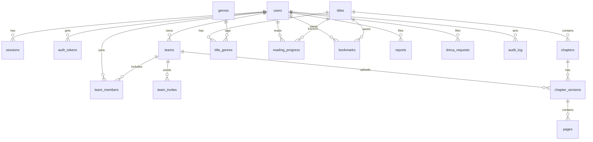
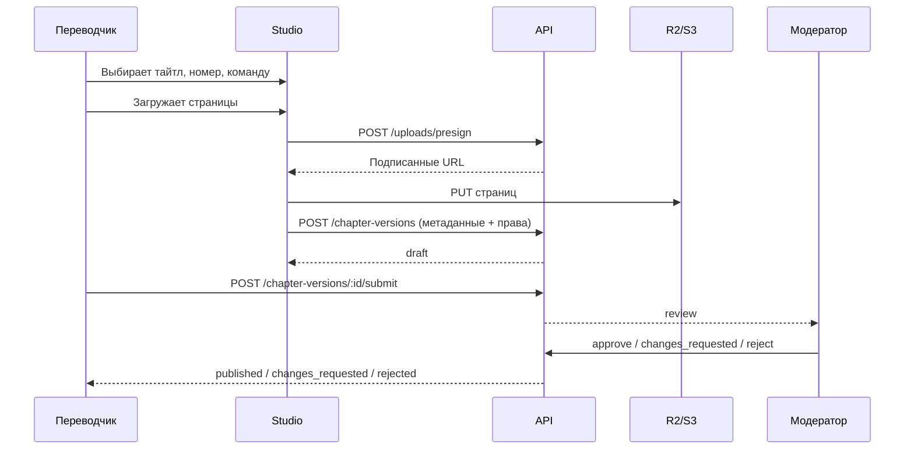

# Kuroha UGC — модель данных и экраны

Черновик для реализации. Дата: 17.11.2026.

Модель: бесплатная русскоязычная библиотека с пользовательскими переводами.
Платформа не копирует каталог, обложки и тексты Senkuro или Remanga. Их интерфейсы
можно изучить как ориентир, но разметка, тексты, ассеты и контент — только свои.

## 1. Границы MVP

В первый запуск входит вертикальный срез:

**каталог → тайтл → загрузка главы командой → модерация → публикация → чтение → жалоба.**

В MVP:

- публичный каталог, страница тайтла и читалка изображений;
- аккаунты: читатель, переводчик, модератор, администратор;
- команды переводчиков и роли внутри команды;
- загрузка главы, проверка прав, очередь модерации;
- серверный прогресс чтения и закладки;
- жалобы и обращения правообладателей;
- журнал действий модераторов.

Вне MVP:

- комментарии, отзывы, оценки, клубы, команды-сообщества, письма;
- аудио, «Ночная читальня», рекомендации, вехи, уведомления;
- платежи, подписки, реклама;
- несколько языков, кроме русского.

Эти функции можно вернуть после запуска, когда есть контент с правами и
модерация.

## 2. Роли и права

| Действие | Гость | Читатель | Переводчик | Владелец команды | Модератор | Админ |
|---|---:|---:|---:|---:|---:|---:|
| Читать опубликованное | да | да | да | да | да | да |
| Прогресс и закладки | — | да | да | да | да | да |
| Создать команду | — | — | — | да | — | да |
| Пригласить в команду | — | — | — | да | — | да |
| Создать invite-ссылку | — | — | — | да | — | да |
| Загрузить черновик | — | — | да | да | — | да |
| Отправить на проверку | — | — | да | да | — | да |
| Проверить и опубликовать | — | — | — | — | да | да |
| Снять с публикации | — | — | — | — | да | да |
| Обработать жалобу | — | — | — | — | да | да |
| Обработать DMCA | — | — | — | — | — | да |
| Управлять пользователями | — | — | — | — | — | да |
| Смотреть аудит | — | — | — | — | да | да |

Правила:

- первый зарегистрированный пользователь **не** становится админом автоматически;
  админ создаётся миграцией или переменной окружения;
- публичная регистрация закрыта: новый аккаунт создаётся только по одноразовой
  invite-ссылке от админа или владельца команды;
- владелец команды приглашает только переводчика или модератора в свою команду;
  роль `admin` выдаёт только админ;
- приглашение живёт 7–30 дней, срабатывает один раз и хранится в БД только
  хешем токена;
- переводчик видит только свои черновики и черновики своей команды;
- модератор не может публиковать тайтл без заполненного статуса прав;
- администратор не может удалить запись из аудита.

## 3. Доменная модель



### 3.1 users

- `id` — uuid;
- `email` — уникальный, регистр не важен;
- `password_hash` — Argon2id, не scrypt;
- `display_name`;
- `role` — `reader / translator / moderator / admin`;
- `status` — `active / suspended / deleted`;
- `email_verified_at`;
- `created_at`, `updated_at`.

### 3.2 sessions и auth_tokens

- `sessions` — серверные сессии, хранится только хеш токена;
- `auth_tokens` — подтверждение email и сброс пароля, одноразовые, с TTL;
- cookie — `HttpOnly`, `Secure`, `SameSite=Lax`, CSRF-токен отдельно.

### 3.3 teams и team_members

- `teams.slug`, `name`, `description`, `avatar_key`, `owner_id`, `status`;
- `team_members.role` — `owner / translator / editor / proofreader`;
- `team_invites` — email, роль, хеш токена, срок, принятие.

### 3.4 titles

- `slug`, `type` (`manga / manhwa / manhua / novel`);
- `title_ru`, `title_original`, `description`;
- `author_name`, `artist_name`;
- `cover_key`, `age_rating` (`0 / 6 / 12 / 16 / 18`);
- `status` — `draft / published / hidden`;
- права:
  - `rights_status` — `licensed / permission / public_domain / cc / unverified`;
  - `rights_holder`, `license_code`, `license_url`, `source_url`;
- `created_by`, `created_at`, `updated_at`.

Правило: `rights_status = unverified` нельзя перевести в `published`.

### 3.5 chapters и chapter_versions

`chapters` — логическая глава тайтла:

- `title_id`, `number`, `volume`, `name`, `language` (MVP — `ru`);
- `status` — `draft / review / published / removed`;
- `published_at`.

`chapter_versions` — конкретный перевод главы командой:

- `chapter_id`, `team_id`, `version`;
- `status` — `draft / review / changes_requested / published / rejected / removed`;
- `rights_note`, `source_url`, `proof_url`;
- `submitted_by`, `reviewed_by`, `reviewed_at`, `rejection_reason`;
- уникальность `(chapter_id, team_id, version)`.

Так у одной главы может быть несколько переводов. Публичная страница показывает
версии, у которых `status = published`.

### 3.6 pages

- `version_id`, `page_number`, `image_key`;
- `width`, `height`, `byte_size`, `checksum`;
- уникальность `(version_id, page_number)`.

В БД хранится ключ объекта в S3/R2, не base64 и не файл. Отдача — через CDN или
подписанный URL.

### 3.7 reading_progress и bookmarks

- `reading_progress` — `user_id`, `title_id`, `chapter_id`, `page`, `percent`,
  `updated_at`; уникальность `(user_id, title_id)`;
- `bookmarks` — `user_id`, `title_id`; уникальность пары.

### 3.8 reports и dmca_requests

`reports`:

- `reporter_id` — может быть null для гостя;
- `target_type` — `title / chapter / user / comment`;
- `target_id`;
- `reason` — `copyright / adult / spam / abuse / quality / other`;
- `message`, `status` (`open / reviewing / resolved / dismissed`);
- `resolution`, `resolved_by`, `resolved_at`.

`dmca_requests`:

- `ticket_code` — публичный номер;
- `requester_name`, `email`, `organization`;
- `target_urls` — массив;
- `work_description`, `proof_url`;
- `good_faith` — подтверждение;
- `status` (`new / reviewing / accepted / rejected`);
- `notes`, `resolved_by`, `resolved_at`.

### 3.9 audit_log

`actor_id`, `action`, `entity_type`, `entity_id`, `meta` (jsonb), `ip`, `created_at`.
Пишется на публикацию, снятие, решение по жалобе и DMCA, смену ролей.

## 4. Статусы

### 4.1 Версия главы

```text
draft ──submit──> review ──approve──> published ──remove──> removed
  ^                 │
  └──changes_requested──┘
                    │
                    └──reject──> rejected
```

- `draft` — видит команда;
- `review` — видит модератор, публично не видно;
- `changes_requested` — нужны правки, можно вернуть в `draft`;
- `published` — видно читателям;
- `rejected` — окончательный отказ, причина обязательна;
- `removed` — снято после публикации, причина обязательна.

### 4.2 Жалоба

`open → reviewing → resolved | dismissed`.

### 4.3 DMCA

`new → reviewing → accepted | rejected`.

## 5. Потоки

### 5.1 Загрузка главы



Обязательные поля при отправке:

- тайтл, номер и название главы;
- команда и язык;
- страницы в правильном порядке;
- статус прав и подтверждение;
- источник и ссылка на разрешение, если есть;
- заявление: «у меня есть право на публикацию этого перевода».

### 5.2 Модерация

1. Модератор открывает очередь.
2. Проверяет превью страниц, метаданные, права и историю команды.
3. Решение:
   - опубликовать;
   - вернуть на правки с комментарием;
   - отклонить с причиной.
4. Каждое решение пишется в `audit_log`.
5. Команда получает уведомление в студии; email — после MVP.

### 5.3 Жалоба правообладателя

1. Правообладатель открывает `/rights`.
2. Заполняет форму и получает `ticket_code`.
3. Админ проверяет ссылки, доказательства и связь с тайтлом.
4. При принятии — контент скрывается, версия получает `removed`, команда
   уведомляется, запись остаётся в аудите.
5. При отказе — причина фиксируется, заявитель получает ответ.

### 5.4 Чтение

1. Читатель открывает тайтл, выбирает перевод.
2. Сервер отдаёт только `published` версии.
3. Страницы грузятся через CDN, первые 2–3 — с приоритетом.
4. Прогресс сохраняется на сервере, если пользователь вошёл; иначе локально.
5. При снятии версии читатель видит понятное состояние «глава снята», а не 404.

### 5.5 Онбординг по приглашению

Публичная регистрация закрыта. Новый переводчик или модератор попадает на
платформу только по ссылке.

1. Админ открывает студию → «Приглашения»; владелец команды — тот же блок для
   своей команды.
2. Указывает email (необязательно), роль (`translator` или `moderator`;
   `admin` — только админ), команду и срок 7/14/30 дней.
3. Получает ссылку `studio.html?invite=<token>` один раз и передаёт её лично.
4. Человек открывает ссылку, видит команду и роль, вводит имя, email и пароль.
   Если приглашение выдано на email, он должен совпасть.
5. Аккаунт создаётся с нужной глобальной ролью, человек сразу входит в студию и
   при наличии команды становится её участником (`translator` или `moderator`,
   не `owner`).
6. Приглашение помечается использованным. Повторная ссылка, истёкшее или
   отозванное приглашение показывают спокойную ошибку и обычный вход.

Ограничения локального среза: письма не отправляются, ссылку передают вручную;
`token` хранится только в виде `sha256`-хеша; отзыв доступен админу и владельцу
команды. Первый пользователь пустой базы в прототипе всё ещё получает `admin`
по legacy-правилу — это исключение, а не часть продуктового онбординга.

## 6. Экраны

### 6.1 Студия команды

Маршрут: `/studio`, `/studio/upload`, `/studio/team`.

```text
┌ Kuroha Studio ──────────────────────────────────────────────┐
│ Команда: [Тихие страницы ▾]              [+ Новая глава]    │
├───────────────┬─────────────────────────────────────────────┤
│ Релизы        │ Черновики · На проверке · Опубликовано      │
│ Черновики     │ ┌─────────────────────────────────────────┐ │
│ На проверке   │ │ Обложка  Название · Глава 12            │ │
│ Команда       │ │          Версия 1 · обновлено 2 ч назад │ │
│ Настройки     │ │          [Черновик]  [Продолжить]       │ │
│               │ └─────────────────────────────────────────┘ │
└───────────────┴─────────────────────────────────────────────┘
```

Состояния:

- пусто — «Пока нет глав. Начни с первой»;
- ошибка загрузки — причина и кнопка «Повторить»;
- нет прав — форма отправки заблокирована с объяснением;
- команда заблокирована — только чтение.

### 6.2 Загрузка главы

Три шага, прогресс сверху.

```text
┌ Новая глава ────────────────────────────────────────────────┐
│ 1 Тайтл  ——  2 Страницы  ——  3 Права и публикация           │
├─────────────────────────────────────────────────────────────┤
│ Тайтл      [Найти тайтл…]                                   │
│ Глава      [12]  Название [________]                        │
│ Команда    [Тихие страницы ▾]   Язык [Русский]              │
│                                                             │
│ Страницы   [Перетащите изображения или выберите]            │
│            [1] [2] [3] [4]  ← перетащить, удалить           │
│                                                             │
│ Права      (•) Разрешение автора  ( ) Лицензия CC           │
│            ( ) Public domain      ( ) Права у команды       │
│ Источник   [https://…]                                      │
│ Доказательство [Загрузить PDF/ссылку]                       │
│ [ ] Подтверждаю право на публикацию                         │
│                                                             │
│ [Сохранить черновик]                     [Отправить]        │
└─────────────────────────────────────────────────────────────┘
```

Проверки:

- номер главы — число больше нуля;
- страницы — только JPEG/PNG/WebP, до 20 МБ каждая, до 200 страниц;
- имя файла не используется как путь;
- изображения перекодируются, EXIF удаляется;
- при `rights_status = unverified` кнопка «Отправить» неактивна.

### 6.3 Очередь модерации

Маршрут: `/admin/moderation`.

```text
┌ Модерация ──────────────────────────────────────────────────┐
│ [Главы 12] [Жалобы 4] [DMCA 1]        Фильтры: [Все ▾]      │
├─────────────────────────────────────────────────────────────┤
│ Глава 12 · Название          Тихие страницы  2 ч назад      │
│ Права: разрешение автора · 18 страниц · [Открыть]           │
├─────────────────────────────────────────────────────────────┤
│ Глава 11 · Название          Луна           вчера           │
│ Права: CC BY 4.0 · 24 страницы · [Открыть]                  │
└─────────────────────────────────────────────────────────────┘
```

Карточка проверки:

- превью страниц с зумом;
- метаданные и права;
- история команды: сколько опубликовано, сколько отклонено;
- кнопки «Опубликовать», «На правки», «Отклонить»;
- обязательный комментарий для двух последних.

### 6.4 Правообладателям / DMCA

Маршрут: `/rights`.

```text
┌ Правообладателям ───────────────────────────────────────────┐
│ Если ваш перевод или глава опубликованы без разрешения,     │
│ заполните форму. Мы ответим на указанный email.             │
│                                                             │
│ Имя            [________]                                   │
│ Email          [________]                                   │
│ Организация    [________]                                   │
│ Ссылки         [________]  по одной на строку               │
│ Произведение   [________]                                   │
│ Доказательство [ссылка или файл]                            │
│ [ ] Добросовестное заявление                                │
│ [Отправить]                                                 │
└─────────────────────────────────────────────────────────────┘
```

После отправки — страница статуса по `ticket_code`. Без email-рассылки статус
можно проверять по номеру.

### 6.5 Публичная страница тайтла

Добавить к текущей `title.html`:

- блок «Переводы»: команда, версия, статус, дата;
- выбор перевода для чтения;
- блок прав: автор, лицензия, источник, переводчик;
- кнопку «Пожаловаться»;
- состояние «У этого тайтла пока нет опубликованных глав».

```text
┌ Название ───────────────────────────────────────────────────┐
│ Обложка   Автор · художник · 2026 · 18+                     │
│           Права: CC BY 4.0 · источник · перевод: команда    │
│           [Начать читать] [На полку] [Пожаловаться]         │
├─────────────────────────────────────────────────────────────┤
│ Переводы: [Тихие страницы ▾]   Главы 1–48                   │
│ 12 · Название · 18 стр. · 2 дня назад                       │
└─────────────────────────────────────────────────────────────┘
```

### 6.6 Читалка

Добавить к текущей `reader.html`:

- выбор версии перевода;
- изображения страниц вместо листов-заглушек;
- прогресс по страницам, а не только по скроллу;
- режимы «по одной» и «две страницы»;
- RTL для манги;
- зум и панорамирование на телефоне;
- прелоад следующих 2–3 страниц;
- состояние «глава снята» с причиной.

## 7. API

Все ответы — JSON. Ошибки: `{ "error": { "code", "message", "fields?" } }`.

### 7.1 Авторизация

| Метод | Маршрут | Назначение |
|---|---|---|
| POST | `/api/auth/register` | регистрация по приглашению (публичная закрыта) |
| POST | `/api/auth/login` | вход, HttpOnly cookie |
| POST | `/api/auth/logout` | выход |
| POST | `/api/auth/verify-email` | подтверждение |
| POST | `/api/auth/password-reset` | запрос сброса |
| POST | `/api/auth/password-reset/confirm` | новый пароль |
| GET | `/api/me` | профиль и роли |

### 7.2 Команды

| Метод | Маршрут | Назначение |
|---|---|---|
| GET | `/api/teams` | публичные команды |
| POST | `/api/teams` | создать команду |
| GET | `/api/teams/:slug` | команда и участники |
| POST | `/api/invites` | приглашение: email, роль, команда, срок |
| GET | `/api/invites` | выданные приглашения и статусы |
| DELETE | `/api/invites/:id` | отозвать приглашение |
| GET | `/api/invites/:token` | публичный просмотр до регистрации |
| PATCH | `/api/teams/:id/members/:userId` | сменить роль |

### 7.3 Тайтлы и главы

| Метод | Маршрут | Назначение |
|---|---|---|
| GET | `/api/titles` | каталог с фильтрами |
| GET | `/api/titles/:slug` | тайтл, права, переводы |
| GET | `/api/titles/:slug/chapters` | опубликованные главы |
| POST | `/api/titles` | создать тайтл (модератор) |
| PATCH | `/api/titles/:id` | метаданные и права |
| POST | `/api/titles/:id/chapters` | логическая глава |
| GET | `/api/chapter-versions/:id/pages` | страницы и подписанные URL |

### 7.4 Загрузка

| Метод | Маршрут | Назначение |
|---|---|---|
| POST | `/api/uploads/presign` | подписанные URL для страниц |
| POST | `/api/uploads/complete` | подтвердить загрузку |
| POST | `/api/chapter-versions` | создать версию |
| PATCH | `/api/chapter-versions/:id` | метаданные и порядок страниц |
| POST | `/api/chapter-versions/:id/submit` | отправить на проверку |
| DELETE | `/api/chapter-versions/:id` | удалить черновик |

### 7.5 Модерация

| Метод | Маршрут | Назначение |
|---|---|---|
| GET | `/api/admin/moderation` | очередь |
| POST | `/api/admin/chapter-versions/:id/approve` | опубликовать |
| POST | `/api/admin/chapter-versions/:id/request-changes` | на правки |
| POST | `/api/admin/chapter-versions/:id/reject` | отклонить |
| POST | `/api/admin/chapter-versions/:id/remove` | снять |
| GET | `/api/admin/audit` | журнал |

### 7.6 Жалобы и DMCA

| Метод | Маршрут | Назначение |
|---|---|---|
| POST | `/api/reports` | жалоба |
| GET | `/api/reports/:ticket` | статус |
| POST | `/api/rights/requests` | обращение правообладателя |
| GET | `/api/rights/requests/:ticket` | статус |
| POST | `/api/admin/reports/:id/resolve` | решение |
| POST | `/api/admin/rights/:id/resolve` | решение |

### 7.7 Чтение

| Метод | Маршрут | Назначение |
|---|---|---|
| PUT | `/api/me/progress/:titleId` | прогресс |
| DELETE | `/api/me/progress/:titleId` | сброс |
| POST | `/api/me/bookmarks/:titleId` | добавить |
| DELETE | `/api/me/bookmarks/:titleId` | убрать |

## 8. Безопасность

- TLS обязателен; cookie только `Secure`, `HttpOnly`, `SameSite=Lax`.
- Пароли — Argon2id; не scrypt и не SHA.
- CSRF-токен для всех изменяющих запросов.
- Rate limit на вход, регистрацию, сброс пароля, загрузку и жалобы.
- Загрузки: проверка MIME по сигнатуре, перекодирование, лимит размера и
  количества страниц, запрет SVG и исполняемых файлов.
- Приватный bucket; публичная выдача — через CDN или подписанные URL с TTL.
- CORS только для доменов Kuroha.
- Security headers: CSP, `X-Content-Type-Options`, `Referrer-Policy`,
  `Permissions-Policy`.
- Роли проверяются на сервере, не в JS.
- Invite-токены: только `sha256`-хеш в БД, TTL 1–30 дней, одноразовое
  использование, необязательная привязка к email; raw-токен не логируется и не
  отдаётся повторно.
- Первый пользователь не становится админом; админ — через миграцию.
- Аудит не редактируется и не удаляется через API.
- Бэкапы БД и объекта хранения; проверка восстановления раз в месяц.

## 9. Юридический контур

Это не юридическая консультация. Перед запуском нужен юрист по авторскому
праву.

Обязательные документы:

- [пользовательское соглашение](legal/terms.md);
- [политика конфиденциальности](legal/privacy.md);
- [документ об авторском праве](legal/copyright.md);
- [страница для правообладателей и DMCA](legal/dmca.md);
- [публичная оферта](legal/offer.md);
- [правила публикации](legal/publishing.md);
- политика повторных нарушителей — уже описана в DMCA;
- возрастная маркировка и 18+ гейт — в соглашении;
- правила обработки персональных данных и удаления аккаунта — в соглашении
  и политике конфиденциальности.

Статус черновиков и список того, что нужно заполнить перед публикацией, —
в [README юридического пакета](legal/README.md).

Для России учитывать ст. 1253.1 ГК РФ об информационном посреднике:
уведомление, сроки, удаление, уведомление загрузившего, контр-уведомление.
Для международных пользователей — DMCA-совместимую форму. Это две разные
процедуры, их нельзя смешивать в одном тексте без юриста.

Правила для переводчиков:

- загружая главу, пользователь подтверждает право на перевод и публикацию;
- платформа получает неисключительную лицензию на хранение, показ и техническую
  обработку;
- при жалобе платформа может скрыть материал до разбирательства;
- повторные нарушения — блокировка загрузки и команды.

## 10. Что меняется в текущем прототипе

| Сейчас | Куда |
|---|---|
| `server/server.js`, `db.json` | новый API + PostgreSQL |
| `cloud.js` и `127.0.0.1:4180` | клиент API с cookie-сессией |
| `admin.html` | разделить на `studio.html` и `admin/moderation.html` |
| `admin.js` | загрузка в R2/S3, а не base64 |
| `title.html` | блок переводов и прав |
| `reader.html`, `pages.js` | изображения страниц, версии, прогресс |
| `teams.html` | профиль команды и её релизы |
| `reports.js` | серверные жалобы и DMCA |
| localStorage `kuroha-progress`, `kuroha-bookmarks` | сервер + локальный кэш для гостя |

Локальный вход и `kuroha-session` в публичном продукте не используются.

## 11. Порядок работ

1. **Права и документы.** 5–10 тайтлов с подтверждёнными правами, юрист,
   тексты правил и DMCA.
2. **База и доступ.** PostgreSQL, миграции, пользователи, сессии, команды,
   роли, аудит.
3. **Загрузка и модерация.** S3/R2, превью, очередь, публикация.
4. **Читалка.** Изображения, версии, прогресс, мобильный зум.
5. **Жалобы и DMCA.** Формы, статусы, уведомления.
6. **Запуск.** Бэкапы, мониторинг, security-проход, нагрузочный тест,
   юридическая проверка.

## 12. Критерии готовности MVP

- Переводчик создаёт команду, загружает 20 страниц и отправляет главу.
- Модератор видит очередь, превью и права, публикует или возвращает на правки.
- Читатель открывает тайтл, выбирает перевод и читает изображения на 360 px.
- Прогресс сохраняется после входа с другого устройства.
- Снятая глава не отдаётся и показывает понятное состояние.
- Жалоба и DMCA создают тикет, решение видно в аудите.
- На 1280 и 360 нет горизонтального скролла, консоль чистая.
- Axe: 0 critical/serious на основных экранах.
- Ни один публичный тайтл не имеет `rights_status = unverified`.

## 13. Открытые вопросы

1. Есть ли уже письменные права хотя бы на один тайтл?
2. Кто будет модератором на старте и сколько часов в день?
3. Нужна ли монетизация в первый год?
4. Один язык или сразу несколько?
5. Кто отвечает за DMCA-процедуру и юридические тексты?
6. Готов ли бюджет на PostgreSQL, R2 и CDN?
